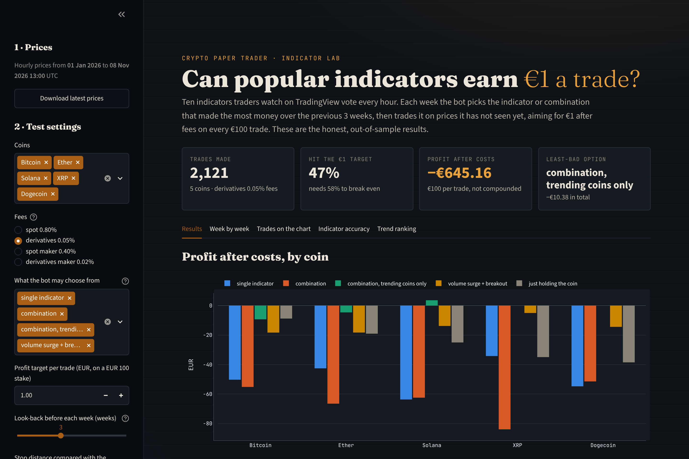
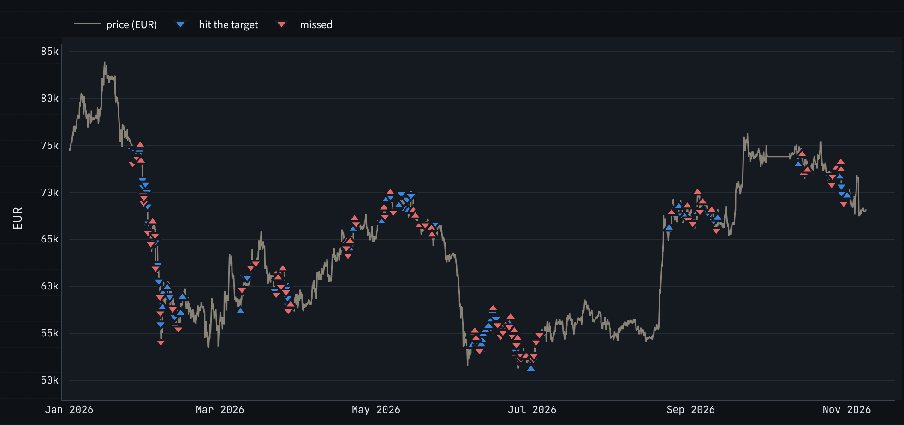
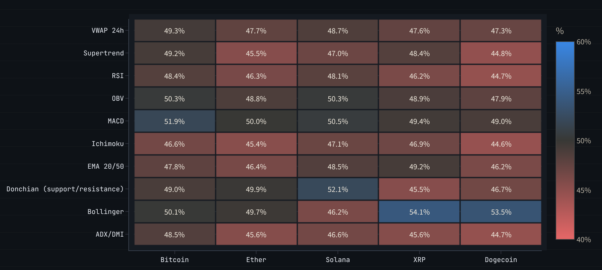

# Crypto Paper Trader: Can Automated Trading Beat the Fees?

**Business question:** Can an automated bot make money trading crypto with €100 once real exchange fees, borrowing costs and slippage are counted? And can popular technical indicators, alone or combined, predict price moves well enough to make €1 on every trade?

**Data:** 10 months of hourly prices (January to November 2026) plus 1-minute and 15-minute prices for Bitcoin, Ether, Solana, XRP and Dogecoin in euro, from [Kraken's quarterly archives](https://support.kraken.com/articles/360047124832-downloadable-historical-ohlcvt-open-high-low-close-volume-trades-data) and [public API](https://docs.kraken.com/api/docs/rest-api/get-ohlc-data). Fees from [Kraken's spot fee schedule](https://www.kraken.com/features/fee-schedule) (checked 4 November 2026) and [derivatives fees](https://support.kraken.com/articles/360048917612).

**Tools:** Python (pandas, NumPy, requests, scikit-learn), Streamlit, Plotly

**Status:** In progress. Three strategies tested, with a Streamlit front end for the indicator lab.



> No real money is traded. "Paper trading" replays real prices with pretend money.

## Key findings

1. **No indicator, alone or combined, could make €1 per trade.** Across 10 popular indicators and 86 combinations, tested week by week on prices the bot had not yet seen, every coin lost money at both fee levels. At derivatives fees, combinations lost €319 over 948 trades (€100 stake each); single indicators lost €245 over 869 trades.
2. **The indicators are close to coin flips.** When an indicator pointed up or down, the price moved that way over the next 24 hours only 44–51% of the time for trend indicators (EMA, MACD, Supertrend, Ichimoku, ADX). The best was Bollinger Bands at 54% on XRP and Dogecoin.
3. **A €1 target needs a high hit rate, because losing trades pay fees too.** At derivatives fees the bot must hit its target 58% of the time to break even (81% at spot fees); it managed 43–49%. With the stop as far away as the target, that is about what coin flips give.
4. **Trading only strongly trending coins cut the losses but did not make money.** Ranking coins each week by how straight their price path was (efficiency ratio) and trading only the top 2, in their trend's direction, lost €10.38 over 119 trades at derivatives fees (−€0.09 a trade, against −€0.34 for all coins). The hit rate rose from 45% to 56%, still short of the 58% needed, and the bot traded in only 10 of 210 coin-weeks, so the sample is small.
5. **Waiting for a breakout after a volume surge did not work either.** A busy day did come before bigger moves (7.3% the next week against 5.6% otherwise), but the breakouts mostly reversed: 6 hours after a surge breakout the price was still going the same way only 37–47% of the time. Following them lost €69.89 over 185 trades at derivatives fees (−€0.38 a trade).

### Further detail

- **Combining indicators did not help.** Combinations lost about as much per trade as single indicators (€0.30–€0.37 against €0.25–€0.32), and traded more often. Even the best combination picked in hindsight lost money on 4 of 5 coins.
- **Scalping cannot beat spot fees.** One buy and one sell costs 1.6%, but the average one-minute Bitcoin move was 0.01%. Over 21 scalping trades, €100 became €70.76, with fees taking €28.52 of the €29.24 lost.
- **Support/resistance breakouts worked best on trending coins:** the Donchian channel called the next 24 hours correctly 53.5% of the time in trending weeks, against 48.6% overall. Every other indicator stayed below 52%.
- **At spot fees the lab's bot mostly refused to trade**, as designed: it traded in only 10 of 210 coin-weeks, because no combination had made money in the previous 3 weeks. The trades it did make still lost.
- **The 15-minute trend strategy beat buy-and-hold at derivatives fees in one falling week (1–8 November)**, mainly through short trades. The 10-month hourly test above suggests this does not hold up over time.
- **Holding was better than trading in 2026:** all five coins fell, but holding lost €9–€39 per €100, less than the indicator strategies lost on most coins.

## Levers tested to make €1 per trade more likely

`py src\experiments.py` re-runs the walk-forward test with one setting changed at a time. Totals below are across the five coins and the four main options (single indicator, combination, trending coins only, volume surge + breakout), €100 per trade, hourly prices for 1 January to 8 November 2026.

| Lever | Setting | Trades | Hit €1 | Break-even | Profit | Per trade |
|---|---|---|---|---|---|---|
| Baseline | derivatives, market orders | 2,121 | 46.7% | 58.3% | −€645.16 | −€0.30 |
| 1 Costs | derivatives, limit orders (0.02% maker) | 2,649 | 44.2% | 53.7% | −€616.83 | −€0.23 |
| 1 Costs | spot, limit orders (0.40% maker) | 210 | 47.1% | 75.2% | −€235.47 | −€1.12 |
| 2 Exits | stop at half the target distance | 1,519 | 30.7% | 44.4% | −€416.59 | −€0.27 |
| 2 Exits | stop at 3× the target distance | 2,720 | 68.3% | 79.2% | −€919.52 | −€0.34 |
| 3 Pickiness | look-back hit rate ≥ break-even + 5 points | 933 | 48.8% | 58.3% | −€235.10 | −€0.25 |
| All three | limit orders + stop 1× + picky | 1,137 | 45.7% | 53.7% | −€227.37 | −€0.20 |

- **Cheaper fees lowered the bar but also the hit rate.** Limit orders cut the break-even hit rate from 58% to 54%, but they fill when the price moves against you, so the hit rate fell from 46.7% to 44.2%.
- **Moving the stop only moves the problem.** A wider stop wins more often but needs a higher hit rate to break even; no stop size closed the gap.
- **Being picky mostly meant trading less.** The stricter rule cut trades from 2,121 to 933 and losses with them, but the loss per trade barely changed (−€0.25 against −€0.30).
- **Fading surge breakouts (betting they fail) lost €76.38 over 216 trades**, and none of its 12 settings made money. Across all 60 results tried, none was profitable.
- **Funding-rate carry (lever 4, `src/funding_carry.py`) was the only lever that made money, but slowly.** Buying €100 of a coin and shorting €100 of its perpetual future, then holding both, collected the funding that futures traders pay. Over 30 October 2025 to 8 November 2026 (8,974 hourly funding periods), Bitcoin and Ether each earned €3.79 in funding, or €2.95 after fees with limit orders (2.9% a year): about €1 every 99 days, not €1 a trade. Solana, XRP and Dogecoin earned €0.69–€2.35. Switching the trade on only after a week of positive funding lost money on every coin (−€1.78 to −€34.11), because funding changed direction often and every switch paid fees. A real version also needs extra money as margin for the short and carries euro/dollar and exchange risk, as Kraken's perpetuals are priced in US dollars.
- **Not tested:** market making and arbitrage between exchanges need live order-book data, which hourly candles do not contain.

## What winning trades have in common (`src/pattern_study.py`)

Every hour, for every coin, the study imagines a long and a short trade with the €1 target (62,960 possible trades) and records 15 measurements of the market at that moment: volatility, trend, momentum, volume, time of day, how many indicators agreed, what Bitcoin was doing, and more. It looks for patterns **only in January–June**, then tests them on **July–November**, which the search never saw.

| Scenario (derivatives fees, one trade at a time) | Jan–Jun hit rate | Jan–Jun per trade | Jul–Nov trades | Jul–Nov hit rate | Jul–Nov profit | Jul–Nov per trade |
|---|---|---|---|---|---|---|
| Every hour, no filter | 47.4% | −€0.29 | 1,580 | 48.6% | −€396.16 | −€0.25 |
| Best single pattern: past week moved 1.6–5.2% in the trade's direction | 51.8% | −€0.18 | 716 | 44.4% | −€257.42 | −€0.36 |
| Decision-tree rule above break-even | 71.4% | €0.32 | 61 | 39.3% | −€25.43 | −€0.42 |
| Model using all 15 measurements: expected hit rate ≥ break-even | 71.0% | €0.28 | 575 | 49.6% | −€137.51 | −€0.24 |
| Same model, its most confident 5% of hours | 76.7% | €0.42 | 287 | 51.9% | −€48.91 | −€0.17 |

- **The patterns that looked strongest were the least real.** Rules that hit the target 71–77% of the time from January to June hit it 39–52% of the time from July to November, below the 58% needed. This is overfitting: searching many combinations always finds some that fitted the past by chance.
- **The steadiest pattern was modest momentum:** trades in the direction of a 1.6–5.2% move over the past week hit 51.7% of the time in the search period, against 49.0% overall. Next came trades where 5 indicators agreed (51.6%) and trades in the direction of Bitcoin's past day (50.8%). None was strong enough to reach break-even, and the momentum pattern itself faded to 44.4% in the test period.
- **No combination of the measurements gave a lasting edge.** The best out-of-sample result, the model's most confident hours, still lost €0.17 a trade.

## Skills demonstrated

- **Python and pandas:** web APIs, large archive downloads, combining files, time-series indicators (EMA, MACD, RSI, ATR, ADX, Supertrend, Ichimoku, Bollinger, Donchian, OBV, VWAP)
- **Backtesting done properly:** walk-forward (out-of-sample) testing, hindsight benchmarks, buy-and-hold benchmarks, fee and borrowing-cost modelling for long and short trades
- **Statistics and machine learning:** directional accuracy of each indicator, break-even hit rates, decision trees and gradient boosting (scikit-learn) with a strict time-based train/test split
- **Data quality:** detecting a 206-hour hole between two data sources and excluding it rather than filling it with fake prices; raw data never overwritten
- **Judgement:** avoiding multicollinearity and hindsight bias, and reporting a negative result clearly

## The app

`streamlit run app.py` opens the indicator lab in the browser. Choose coins, fee level, what the bot may choose from, the profit target, the look-back and the number of trending coins in the sidebar; the results update on their own. A **Download latest prices** button runs `fetch_prices.py`.



*Bitcoin, single indicators at derivatives fees: ▲ long, ▼ short; blue reached the €1 target, red did not. The flat stretch in early October is the gap between Kraken's archive and its live data, where the bot does not trade.*



*Grey is a coin flip (50%), blue is better and red is worse. Almost every cell is grey or red.*

| Tab | Shows |
|---|---|
| Results | Profit by coin for each option against just holding the coin, and hit rate against the break-even line |
| Week by week | Running total of profit, and which combination the bot picked each week |
| Trades on the chart | Every trade marked on the price chart: ▲ long, ▼ short, blue for a hit, red for a miss |
| Indicator accuracy | How often each indicator called the next 24 hours correctly, coin by coin |
| Trend ranking | Each coin's trend strength every week and which coins were traded |

**Design direction: "Night ledger"**, a research notebook for a sceptical trader. Blue-black page, warm paper-coloured text, one amber accent, Fraunces serif headlines, Source Sans 3 body text and JetBrains Mono for data labels. Fonts are bundled in `static/fonts` (SIL Open Font Licence) so the app works offline. Colours live in `.streamlit/config.toml` and the `THEME` dictionary in `app.py`; the three chart colours were checked for colour-blind separation.

## The indicator lab (`src/indicator_lab.py`)

1. **Votes:** each of 10 indicators votes every hour: +1 (up), −1 (down) or 0 (no view).
2. **Families:** indicators are grouped into trend, momentum, mean reversion, support/resistance and volume. A combination uses at most one per family, because two from the same family repeat the same information (multicollinearity). A combination trades only when all its indicators agree.
3. **€1 target:** every trade risks €100 and closes at the price that gives exactly €1 after fees and slippage, at a stop the same price distance away, or after 48 hours.
4. **Walk-forward test:** each week the bot looks back 3 weeks, picks the combination that made the most there (at least 5 trades), and trades it for the next week. If nothing made money, it sits the week out.
5. **Reachability check:** a trade is skipped if the market is too calm for the €1 move to be likely within 2 days.
6. **Volume surge + breakout (optional pool):** a trade is allowed only when the last 24 hours' volume is at least 1.25, 1.5 or 2 times the average day of the past week, and the price closes above its 12, 24 or 48-hour high (long) or below the matching low (short). The walk-forward test picks the best of these 9 variants each week. **Fade surge breakout** uses the same 9 signals reversed, betting the break fails; that idea came from these same 10 months, so its result is biased upwards.
7. **Trending coins only (optional pool):** at the start of each week, coins are ranked by efficiency ratio over the previous week (net price change ÷ total distance travelled; 1 = a straight line, 0 = zig-zag). Only the top 2, with a ratio of at least 0.10, may trade that week, and only in the direction of their trend. A look-back week that touches a hole in the data counts as no trend.

| Output | Contents |
|---|---|
| `output/lab_summary_*.csv` | One row per coin, fee level and pool: trades, hit rate, break-even hit rate, profit, hindsight best, buy-and-hold |
| `output/lab_weeks_*.csv` | Which combination was chosen each week, its look-back profit and its profit that week |
| `output/lab_trades_*.csv` | Every out-of-sample trade |
| `output/lab_accuracy_*.csv` | How often each indicator called the next 24 hours correctly, overall and in trending weeks |
| `output/lab_ranking_*.csv` | Each coin's weekly trend strength and which coins were traded |

### Judgement calls

- If one candle touches both the stop and the target, the stop is assumed to come first (the cautious choice).
- Slippage is set at 0.05% per side for hourly trades, as XRP and Dogecoin trade thinly in euro.
- Shorts pay Kraken's example margin fees (0.02% to open, 0.02% per 4 hours). Real futures charge a funding rate instead.
- Up to 6 empty hours in a row are treated as quiet (price unchanged). Longer runs are holes in the data; there is no trading inside them, for 48 hours before (a trade could run into the hole) or for 80 hours after (indicators rebuilding).

## Other strategies

- **`paper_trader.py`:** scalping on 1-minute Bitcoin prices. Buy 0.05% below the 20-minute average; sell at +0.10%, −0.10% or after 30 minutes.
- **`trend_trader.py`:** long/short trend-following on 15-minute prices. Uptrend when the 20-candle EMA is above the 50-candle EMA; RSI filter; stop 2 × ATR away; compared with buy-and-hold.

### A counting bug, found and fixed

Short trades pay borrowing fees for every 4 hours they stay open, so a short that reached its target after more than 4 hours kept €0.98 rather than €1.00. The first version counted a hit as "profit of at least €0.99", which counted those shorts as misses and understated hit rates. Hits now mean "reached the target price". Profit totals were never affected; the hit rates above and the stricter-confidence results (which choose by hit rate) are the corrected ones.

## Data-quality log

| Check | Result |
|---|---|
| Hourly archive rows | Complete: one row per hour for every coin in Q1 (2,160), Q2 (2,184) and Q3 (2,208) 2026 |
| Hole between sources | 1–9 October 2026 (206 hours): after the last published archive (Q3) and before the live API's 30 days. Excluded from trading |
| 1-minute candles with no trades (of 720, 8 Nov) | Bitcoin 9, Ether 107, Solana 124, XRP 324, Dogecoin 557: thin euro markets, so 1-minute results for XRP and Dogecoin are unreliable |
| Duplicate candles across files | Removed when files are combined |

## Running it

```powershell
py src\download_history.py   # once: hourly archives for Jan-Sep 2026 (about 1.6 GB downloaded, then deleted)
py src\fetch_prices.py       # latest 1-minute, 15-minute and hourly prices
py src\indicator_lab.py      # walk-forward indicator test
py src\paper_trader.py       # scalping test
py src\trend_trader.py       # 15-minute trend test
py src\experiments.py       # the levers above, one at a time
py src\funding_carry.py     # funding-rate carry study (downloads Kraken Futures funding history)
py src\pattern_study.py     # what winning trades have in common, tested on unseen months
streamlit run app.py         # the front end
```

Run `fetch_prices.py` at least weekly; overlapping downloads are combined automatically.

## Setup

Python 3 on Windows.

```powershell
git clone https://github.com/Ayoola-droid/crypto-paper-trader.git
cd crypto-paper-trader
py -m venv .venv
.venv\Scripts\Activate.ps1
pip install -r requirements.txt
```

If PowerShell blocks the activate script, run `Set-ExecutionPolicy -Scope CurrentUser RemoteSigned` once.

## Scripts

| Script | What it does |
|---|---|
| `app.py` | Streamlit front end for the indicator lab |
| `src/download_history.py` | Downloads Kraken's quarterly archives and keeps only hourly prices for the five coins |
| `src/fetch_prices.py` | Downloads the latest 1-minute, 15-minute and hourly prices and prints a first inspection |
| `src/indicator_lab.py` | Walk-forward test of 10 indicators and 86 combinations with a €1 profit target, with optional trending-coins filter |
| `src/experiments.py` | Re-runs the indicator lab with cheaper fees, different stops and a stricter confidence rule |
| `src/funding_carry.py` | Downloads Kraken Futures funding rates and measures a carry trade (long coin + short perpetual) after costs |
| `src/pattern_study.py` | Finds patterns in winning trades in Jan–Jun and tests them on Jul–Nov |
| `src/paper_trader.py` | Scalping backtest on Bitcoin, at four fee levels |
| `src/trend_trader.py` | Long/short 15-minute trend backtest on five coins, against buy-and-hold |

## Project structure

```
crypto-paper-trader/
├── docs/              screenshots of the app
├── data/
│   ├── history/       hourly prices from Kraken's quarterly archives
│   ├── funding/       Kraken Futures funding rates
│   ├── raw/           one CSV per coin, candle size and API download; never edited
│   └── archive/       temporary ZIP downloads (not committed)
├── output/            results and trade logs (not committed)
├── static/fonts/      bundled fonts for the app, with licences
├── .streamlit/        app theme (colours and fonts)
├── src/
├── app.py
├── requirements.txt
└── README.md
```

## Commit convention

Commits follow [Conventional Commits](https://www.conventionalcommits.org/en/v1.0.0/), with one project-specific type: `data` for adding raw data files.
